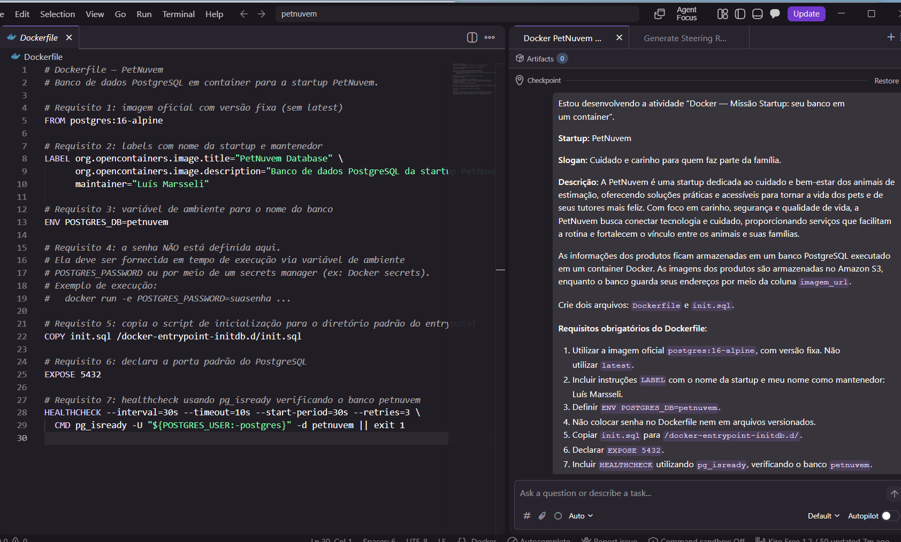
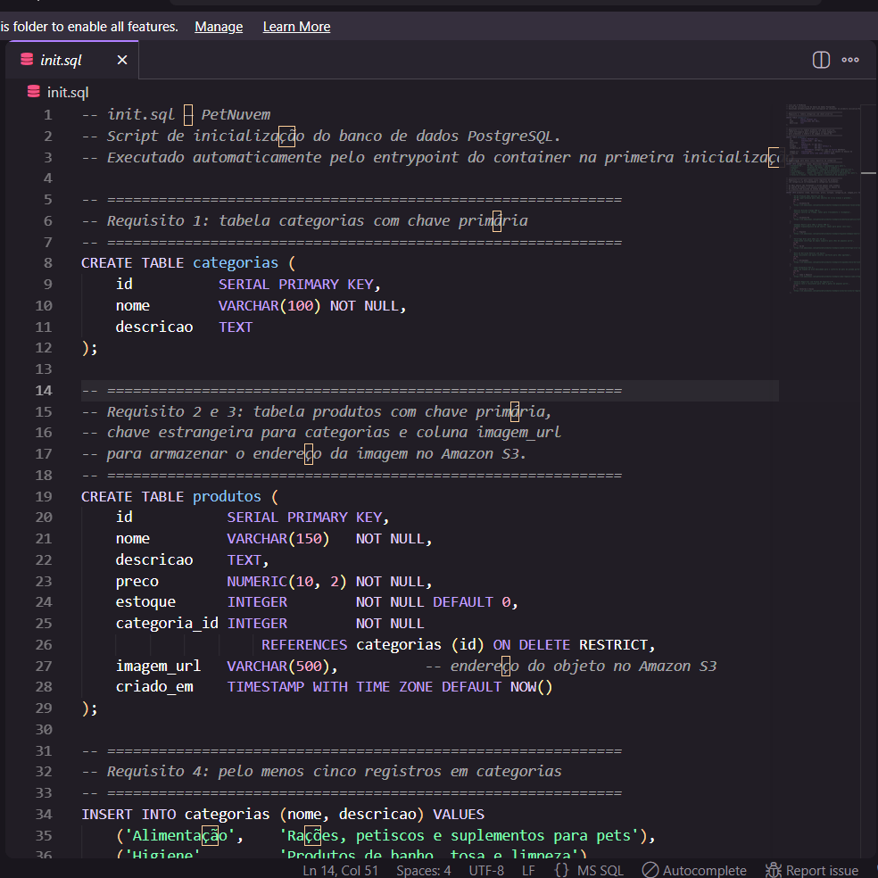
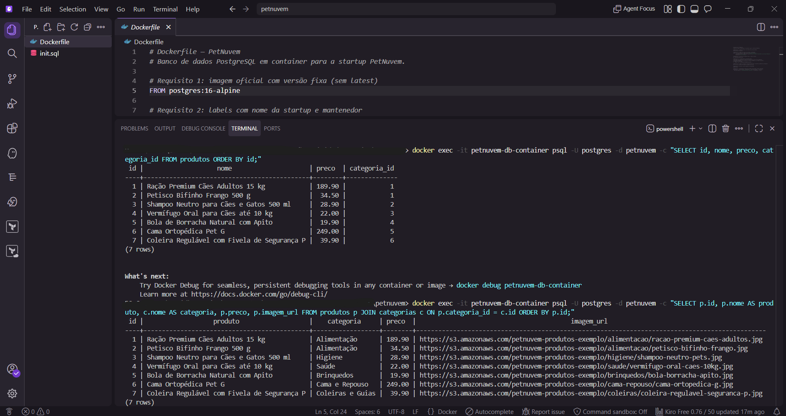
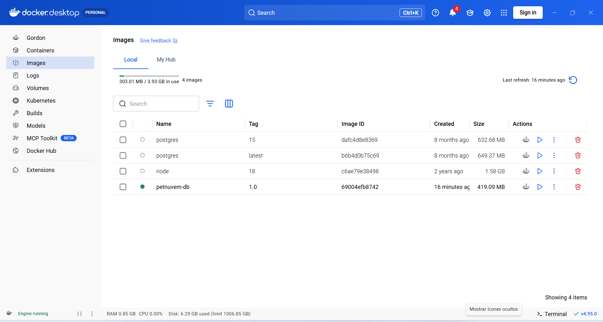
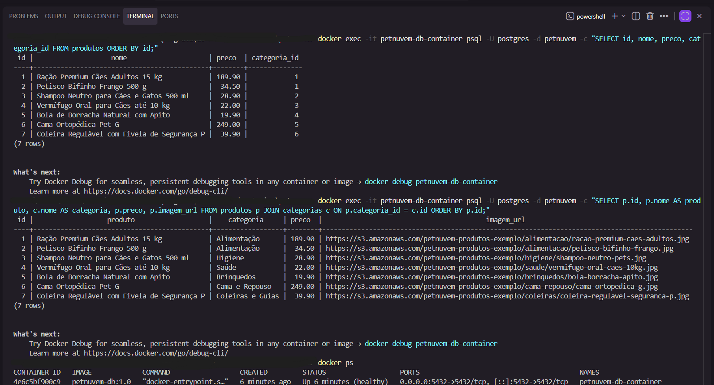
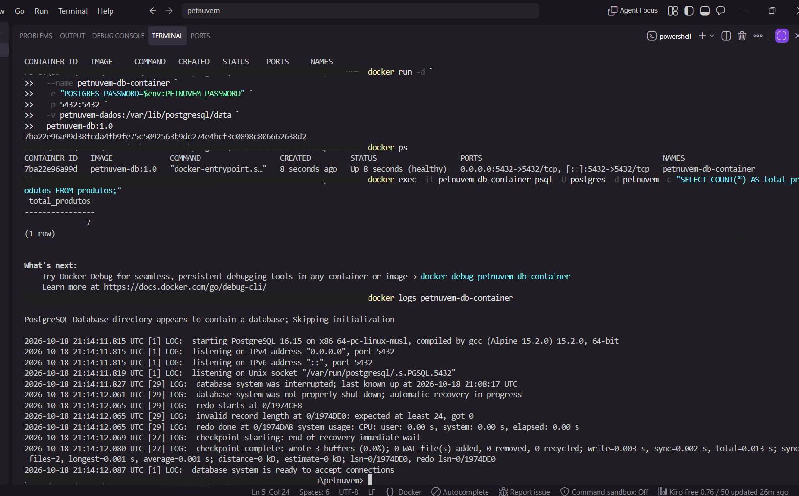
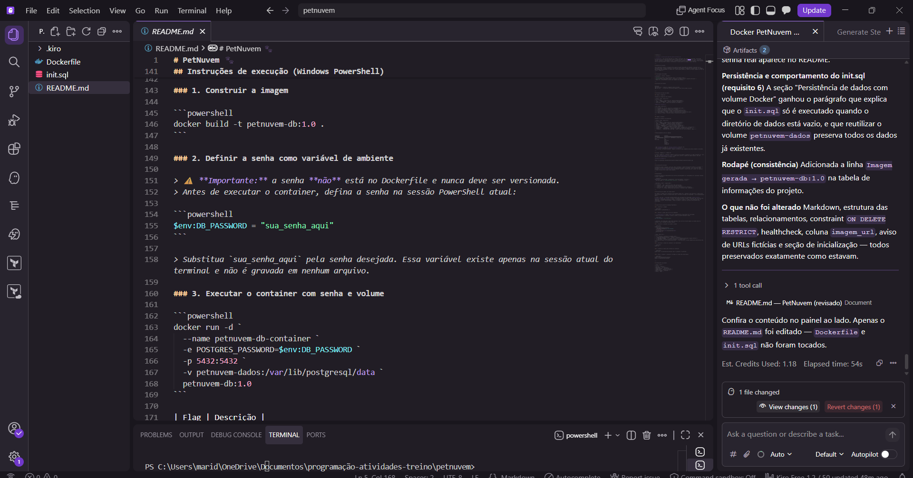

> Startup **fictícia** feita para atividade proposta aos residentes do Capacita iRede.

# PetNuvem 🐾

> **Cuidado e carinho para quem faz parte da família.**

A **PetNuvem** é uma startup dedicada ao cuidado e bem-estar dos animais de estimação, oferecendo soluções práticas e acessíveis para tornar a vida dos pets e de seus tutores mais feliz. Com foco em carinho, segurança e qualidade de vida, a PetNuvem busca conectar tecnologia e cuidado, proporcionando serviços que facilitam a rotina e fortalecem o vínculo entre os animais e suas famílias.

---

## Objetivo do projeto

Este repositório contém a configuração do banco de dados PostgreSQL da PetNuvem, executado em um container Docker. O banco armazena as informações dos produtos e categorias da plataforma. As imagens dos produtos são hospedadas no Amazon S3; o banco guarda apenas os endereços dessas imagens por meio da coluna `imagem_url`.

> A solução foi desenvolvida para praticar conceitos de conteinerização, modelagem relacional, inicialização automatizada de bancos de dados e persistência de dados.

---

## Tecnologias utilizadas

| Tecnologia | Versão / Detalhe |
|---|---|
| [PostgreSQL](https://www.postgresql.org/) | 16 (Alpine Linux) |
| [Docker](https://www.docker.com/) | Container da imagem oficial `postgres:16-alpine` |
| Amazon S3 | Armazenamento externo das imagens dos produtos |
| KIRO | IDE |

> O uso da ferramenta KIRO foi solicitação obrigatória pela atividade, afim de fomentar a familiaridade com esse ambiente de desenvolvimento.

---

## Estrutura do projeto

```
petnuvem/
├── Dockerfile   # Define a imagem do banco de dados
└── init.sql     # Script de criação das tabelas e inserção dos dados iniciais
```

---

## Estrutura do banco de dados

### Tabela `categorias`

Armazena as categorias dos produtos.

| Coluna | Tipo | Descrição |
|---|---|---|
| `id` | `SERIAL` | Chave primária, gerada automaticamente |
| `nome` | `VARCHAR(100)` | Nome da categoria (obrigatório) |
| `descricao` | `TEXT` | Descrição opcional da categoria |

**Registros iniciais:**

| id | nome | descricao |
|---|---|---|
| 1 | Alimentação | Rações, petiscos e suplementos para pets |
| 2 | Higiene | Produtos de banho, tosa e limpeza |
| 3 | Saúde | Medicamentos, vitaminas e acessórios veterinários |
| 4 | Brinquedos | Brinquedos e itens de entretenimento para pets |
| 5 | Cama e Repouso | Camas, casinhas e cobertores para o descanso dos pets |
| 6 | Coleiras e Guias | Coleiras, guias e acessórios de passeio |

---

### Tabela `produtos`

Armazena os produtos da plataforma.

| Coluna | Tipo | Descrição |
|---|---|---|
| `id` | `SERIAL` | Chave primária, gerada automaticamente |
| `nome` | `VARCHAR(150)` | Nome do produto (obrigatório) |
| `descricao` | `TEXT` | Descrição opcional do produto |
| `preco` | `NUMERIC(10,2)` | Preço do produto (obrigatório) |
| `estoque` | `INTEGER` | Quantidade em estoque (padrão: 0) |
| `categoria_id` | `INTEGER` | Chave estrangeira para `categorias.id` (obrigatório) |
| `imagem_url` | `VARCHAR(500)` | Endereço da imagem do produto no Amazon S3 |
| `criado_em` | `TIMESTAMP WITH TIME ZONE` | Data e hora de criação (padrão: `NOW()`) |

---

## Relacionamento entre as tabelas

```
categorias          produtos
──────────          ────────────────────────────────────
id  ◄───────────── categoria_id  (REFERENCES categorias.id)
nome                id
descricao           nome
                    descricao
                    preco
                    estoque
                    imagem_url
                    criado_em
```

- Uma **categoria** pode ter **muitos produtos** (relação 1:N).
- Um **produto** pertence a **exatamente uma categoria**.
- A constraint `ON DELETE RESTRICT` impede a exclusão de uma categoria que possua produtos vinculados.

---

## Coluna `imagem_url` e Amazon S3

A coluna `imagem_url` armazena o endereço público de um objeto no Amazon S3. As URLs presentes no `init.sql` são **exclusivamente fictícias**, criadas para ilustrar o padrão de endereçamento. Elas não apontam para nenhum bucket ou arquivo real.

**Formato de exemplo:**
```
https://s3.amazonaws.com/petnuvem-produtos-exemplo/categoria/nome-do-produto.jpg
```

---

## Inicialização do banco

O Dockerfile copia o arquivo `init.sql` para o diretório `/docker-entrypoint-initdb.d/` da imagem. O entrypoint oficial do PostgreSQL executa automaticamente todos os arquivos `.sql` presentes nesse diretório na **primeira inicialização** do container (quando o volume ainda está vazio). As tabelas e os dados iniciais são criados nesse momento.

---

## Healthcheck

O Dockerfile define um healthcheck que verifica periodicamente se o PostgreSQL está aceitando conexões no banco `petnuvem`:

```dockerfile
HEALTHCHECK --interval=30s --timeout=10s --start-period=30s --retries=3 \
  CMD pg_isready -U "${POSTGRES_USER:-postgres}" -d petnuvem || exit 1
```

| Parâmetro | Valor | Significado |
|---|---|---|
| `--interval` | 30s | Intervalo entre cada verificação |
| `--timeout` | 10s | Tempo máximo para o probe responder |
| `--start-period` | 30s | Tempo de tolerância na inicialização do container |
| `--retries` | 3 | Falhas consecutivas para marcar o container como `unhealthy` |

---

## Persistência de dados com volume Docker

Por padrão, os dados de um container são perdidos quando ele é removido. Para persistir o banco entre reinicializações, mapeie um volume Docker para o diretório de dados do PostgreSQL (`/var/lib/postgresql/data`).

O script `init.sql` é executado automaticamente pelo entrypoint do PostgreSQL **apenas quando o diretório de dados está vazio**, ou seja, na primeira vez que o volume é utilizado. Nas inicializações seguintes, o PostgreSQL encontra os dados já existentes e ignora o script. Isso significa que, ao reutilizar o volume `petnuvem-dados`, todas as tabelas e registros inseridos anteriormente são preservados.

---

## Instruções de execução (Windows PowerShell)

### 1. Construir a imagem

```powershell
docker build -t petnuvem-db:1.0 .
```

### 2. Definir a senha como variável de ambiente

> ⚠️ **Importante:** a senha **não** está no Dockerfile e nunca deve ser versionada.
> Antes de executar o container, defina a senha na sessão PowerShell atual:

```powershell
$env:DB_PASSWORD = "sua_senha_aqui"
```

> Substitua `sua_senha_aqui` pela senha desejada. Essa variável existe apenas na sessão atual do terminal e não é gravada em nenhum arquivo.

### 3. Executar o container com senha e volume

```powershell
docker run -d `
  --name petnuvem-db-container `
  -e POSTGRES_PASSWORD=$env:DB_PASSWORD `
  -p 5432:5432 `
  -v petnuvem-dados:/var/lib/postgresql/data `
  petnuvem-db:1.0
```

| Flag | Descrição |
|---|---|
| `-d` | Executa o container em segundo plano |
| `--name petnuvem-db-container` | Nomeia o container |
| `-e POSTGRES_PASSWORD` | Lê a senha da variável de ambiente definida no passo anterior |
| `-p 5432:5432` | Publica a porta do container na máquina local |
| `-v petnuvem-dados:/var/lib/postgresql/data` | Cria/reutiliza o volume nomeado para persistência dos dados |

### 4. Verificar o status do container e do healthcheck

```powershell
docker ps
```

### 5. Conectar ao banco pelo terminal do container

```powershell
docker exec -it petnuvem-db-container psql -U postgres -d petnuvem
```

### 6. Parar e remover o container (os dados no volume são preservados)

```powershell
docker stop petnuvem-db-container
docker rm petnuvem-db-container
```

---

## Informações do projeto

| Campo | Valor |
|---|---|
| Startup | PetNuvem |
| Mantenedor | Luís Marsseli |
| Imagem gerada | `petnuvem-db:1.0` |
| Imagem base | `postgres:16-alpine` |
| Banco de dados | `petnuvem` |
| Porta | `5432` |


## Evidências do projeto

As capturas abaixo registram etapas da configuração, execução e validação do banco de dados PostgreSQL utilizando Docker.


### Criação Dockerfile e init.sql 





> O KIRO apenas com o prompt inicial, contruiu o Dockerfile e init.sql

### Evidência de consulta ao banco de dados PostgreSQL



> execução de comandos SQL no container Docker da PetNuvem, demonstrando a consulta e a integração entre as tabelas de produtos e categorias, com seus respectivos preços e URLs das imagens.

### Docker



> Docker do banco de dados do projeto Pet Nuvem

### Banco de dados do projeto PetNuvem utilizando Docker e PostgreSQL


> Foram realizadas consultas SQL para listar os produtos cadastrados, seus preços, categorias e URLs das imagens, confirmando a integração entre as tabelas de produtos e categorias e o funcionamento do banco de dados.

### Teste de persistência



> O contêiner está em execução e saudável, com o banco de dados iniciado e pronto para aceitar conexões. 
> Também foi realizada uma consulta SQL que confirmou a existência de 7 produtos cadastrados na tabela produtos.

### Criação do README.me com prompt no KIRO



> Algumas modificações e observações foram feitas manualmente para garantir a máxima qualidade do projeto apresentado. 
